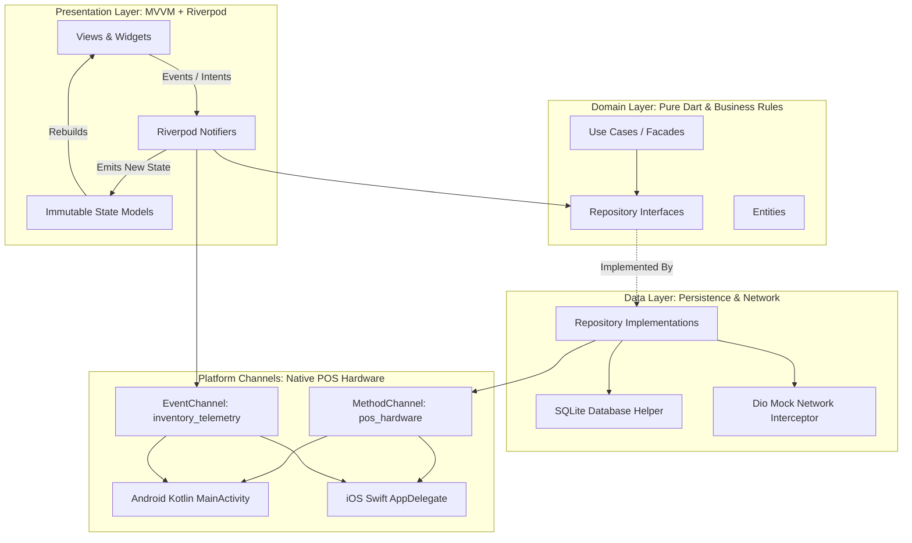
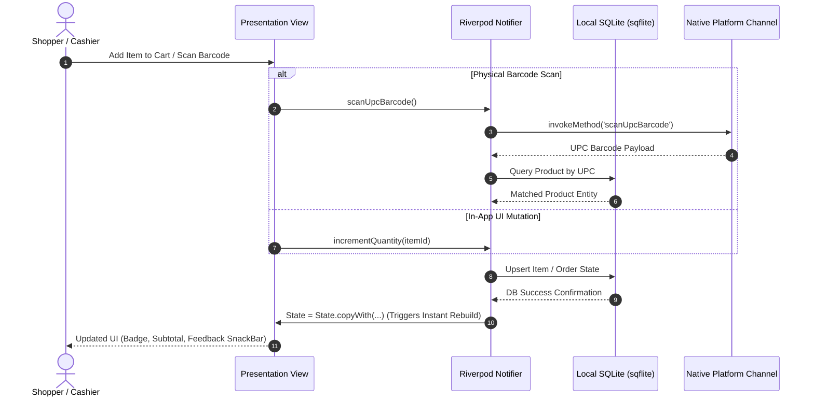
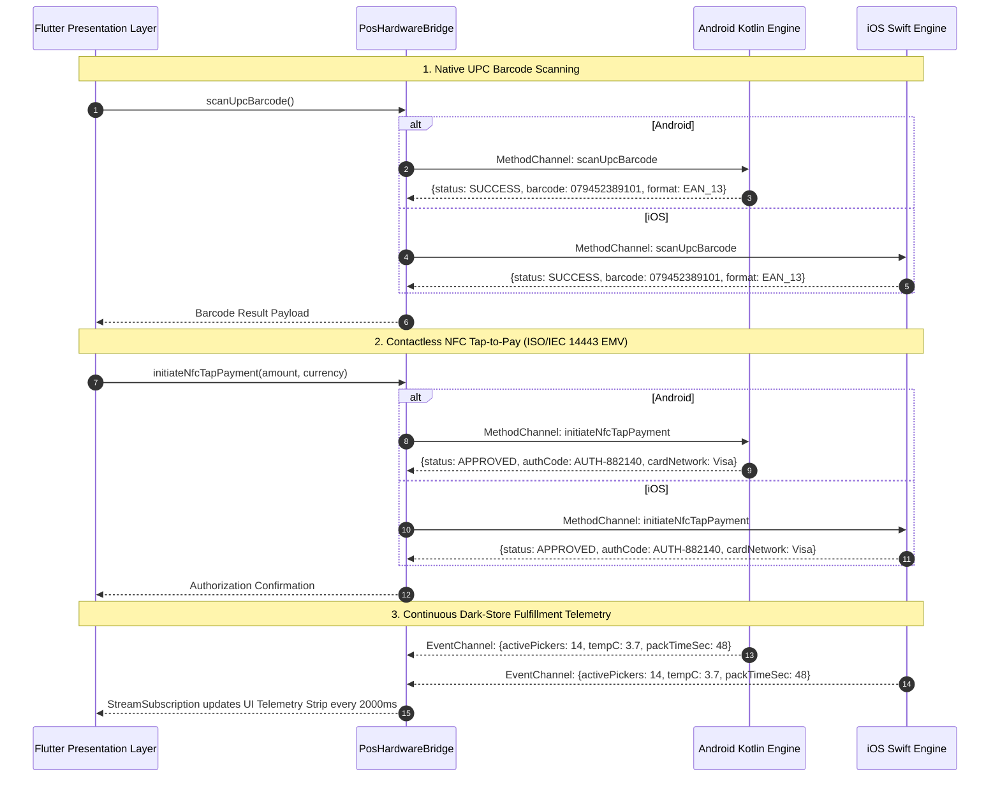

# OmniCart

OmniCart is an enterprise omni-channel e-commerce and micro-fulfillment platform developed in Flutter. It unifies hyper-local 15-minute dark-store fulfillment, native in-store point-of-sale (POS) hardware integration via Kotlin and Swift platform channels, real-time courier route tracking (`flutter_map`), and an on-device AI shopping assistant and merchant copilot.

---

## Architecture Overview

OmniCart is structured around Feature-First Clean Architecture combined with Model-View-ViewModel (MVVM) and Riverpod state management. Each functional domain is strictly decoupled into independent layers:

---

## Riverpod State Flow & Persistence Cycle

---

## Native Retail POS Hardware Bridge

OmniCart communicates directly with Android (`MainActivity.kt`) and iOS (`AppDelegate.swift`) through dedicated platform channels without reliance on paid third-party SDKs.

---

## Feature Matrix

| Capability | OmniCart Platform | Standard E-Commerce Apps |
| :--- | :--- | :--- |
| **Catalog Discovery** | 24+ SKUs across 5 core categories with real-time stock and cold-zone coordinates | Static remote catalog without shelf indexing |
| **Micro-Fulfillment** | 15-minute quick-commerce delivery simulation with dynamic ETA stepper | Standard 3-5 business day shipping estimates |
| **POS Barcode Scanner** | Native camera/hardware reticle with laser pulse and UPC matching | None or third-party paid camera wrapper |
| **Contactless NFC POS** | EMV contactless simulation via native Kotlin and Swift bridges | Web-redirect payment gateways only |
| **Thermal Receipts** | ESC/POS printable raw byte payload generation for thermal receipt printers | Email receipts only |
| **Dark-Store Telemetry** | 2-second streaming telemetry for pickers, pack times, and cold-zone temperature | Static warehouse inventory synchronization |
| **Live Route Tracking** | Interactive OpenStreetMap (`flutter_map`) with polyline bearing and live courier marker | Static map snapshot or external map app redirect |
| **On-Device AI Copilot** | Natural language intent processor for catalog search and restock queries | Remote chatbot requiring recurring paid subscriptions |
| **Data Analytics** | Responsive edge-to-edge `fl_chart` for spend and savings trends | External dashboard or basic text summary |
| **Offline First** | Full `sqflite` persistence across catalog, orders, cart items, and reviews | Screen freezes or displays blank error states |
| **Landscape Ergonomics** | 360dp height adaptive layout with scrollable navigation rail and compressed app bar | Bottom navigation overflow stripes and cut-off content |
| **Theme Engine** | Obsidian Commerce Dark and Crisp Retail Light with zero hardcoded colors | Fixed single theme or partial dark mode support |

---

## Viewport Safety & Landscape Ergonomics (360dp Height Safe)

OmniCart provides robust responsiveness down to a 360dp height viewport (standard mobile landscape):
- **Adaptive Navigation Rail**: On landscape mode, the bottom navigation bar is replaced with a compact, vertically scrollable `NavigationRail` wrapped in an `IntrinsicHeight` container to prevent vertical overflows.
- **Compressed App Bar**: Top app bar height dynamically reduces to `toolbarHeight: 36` with micro-typography.
- **Explicit Grid Extents**: All catalog and cart grids enforce explicit `mainAxisExtent` (e.g. `145dp`) rather than collapsing aspect ratios, eliminating `RenderFlex` overflow errors.
- **Independent Panes**: Master-detail layouts utilize independent scroll controllers for left and right viewports.

---

## Clean-Room Engineering & NDA Compliance Notice

All business logic, platform bridge implementations, schema models, and mock datasets within OmniCart have been authored under strict clean-room engineering principles. No proprietary APIs, production trade secrets, or copyrighted third-party assets are utilized. All brand representations and product entities are synthetic demonstrations designed to illustrate enterprise architectural competencies.
